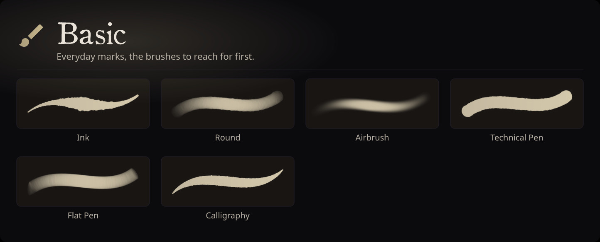
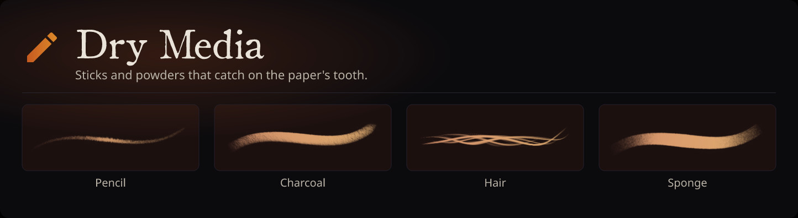
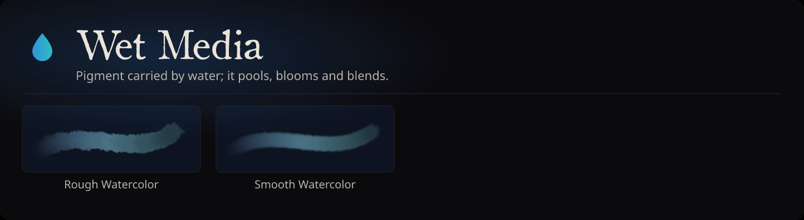
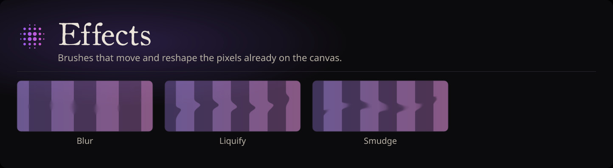
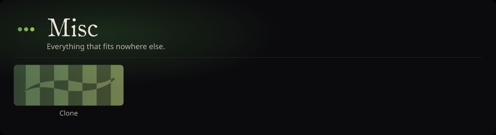

# Brush System Documentation

Darkly's brush system is a **node-graph brush engine** running on the GPU.
This directory holds the reference material; code lives in
[`crates/darkly/src/brush/`](../../crates/darkly/src/brush/) and
[`crates/darkly/shaders/brush/`](../../crates/darkly/shaders/brush/).

Start here:

- **[architecture.md](architecture.md)** - runtime: how strokes flow from tablet
  to canvas. Stroke engine, stroke buffer, terminals, per-dab GPU dispatch.
  **Read this first if you are touching anything in `brush/` or wondering why a
  new brush doesn't appear on the canvas.**
- **[node-system.md](node-system.md)** - authoring: how to define a new node
  type and wire up a preset. Ports, params, `PresetBuilder`, exposed knobs.
- **[stabilization.md](stabilization.md)** - stabilizer algorithms (Laplacian
  smoother) and their config surface.

Prior-art references (for research, not implementation detail):

- [krita-brush-system.md](krita-brush-system.md): Krita's paintop engines and preset format
- [infinite-painter-engine.md](infinite-painter-engine.md): Infinite Painter's stabilization and dab engine
- [brush-packs-prior-art.md](brush-packs-prior-art.md): what every serious paint
  program ships as default brushes, how they are grouped and named, which ones
  artists use, and the pack lineup that evidence supports. Synthesizes the
  per-program surveys: [what-artists-use.md](what-artists-use.md),
  [krita-default-brushes.md](krita-default-brushes.md),
  [mypaint-default-brushes.md](mypaint-default-brushes.md),
  [gimp-default-brushes.md](gimp-default-brushes.md),
  [photoshop-default-brushes.md](photoshop-default-brushes.md),
  [fresco-default-brushes.md](fresco-default-brushes.md),
  [procreate-default-brushes.md](procreate-default-brushes.md),
  [clip-studio-paint-default-brushes.md](clip-studio-paint-default-brushes.md),
  [paint-tool-sai-default-brushes.md](paint-tool-sai-default-brushes.md),
  [medibang-firealpaca-default-brushes.md](medibang-firealpaca-default-brushes.md),
  [corel-painter-default-brushes.md](corel-painter-default-brushes.md),
  [rebelle-default-brushes.md](rebelle-default-brushes.md),
  [artrage-default-brushes.md](artrage-default-brushes.md),
  [infinite-painter-default-brushes.md](infinite-painter-default-brushes.md),
  [other-paint-programs-default-brushes.md](other-paint-programs-default-brushes.md)

## Brush packs

A pack is a named, iconed, coloured group of brushes: one YAML file under
[`crates/darkly/packs/`](../../crates/darkly/packs/) naming its palette and its
members. Membership lives on the pack, never on the brush, so a brush may be in
several packs and copying it into one never removes it from another. The cards
below are generated from the shipped packs (see
[`docs/generated-markdown.md`](../generated-markdown.md)); each stroke is the
brush's own preview, tinted with its pack's colours.

<!-- darkly:catalog-graphic catalog=brushPacks entry=basic -->

<!-- /darkly:catalog-graphic -->

<!-- darkly:catalog-graphic catalog=brushPacks entry=dry_media -->

<!-- /darkly:catalog-graphic -->

<!-- darkly:catalog-graphic catalog=brushPacks entry=wet_media -->

<!-- /darkly:catalog-graphic -->

<!-- darkly:catalog-graphic catalog=brushPacks entry=effects -->

<!-- /darkly:catalog-graphic -->

<!-- darkly:catalog-graphic catalog=brushPacks entry=misc -->

<!-- /darkly:catalog-graphic -->

## Importers

### Krita brush inspector (debug/analysis tool)

A web-based inspector for Krita `.kpp` preset files. Reach it by opening
the dev frontend at `https://localhost:5173/?brush-inspect` (after
`cd frontend && npm start`). Drop a `.kpp` to see the paintop ID, every PNG
chunk, every `<param>` with decoded curves and sensor IDs, the raw preset
XML, and each embedded brush-tip resource rendered as an image (PNG / JPEG /
SVG). GBR / GIH / ABR tips show a fallback panel with the format label and
magic bytes: no native preview yet; we'll add a parser the first time a
brush in the wild needs it.

Where to find `.kpp` files to test with:

- Artist-saved presets:
  - Linux: `~/.local/share/krita/paintoppresets/`
  - macOS: `~/Library/Application Support/krita/paintoppresets/`
  - Windows: `%APPDATA%\krita\paintoppresets\`
- Krita's bundled defaults ship inside `krita.appimage` / the install dir;
  for direct browsing, the upstream source has them at
  [`krita/krita/data/paintoppresets/`](../../krita/krita/data/paintoppresets/)
  and a wider set of test fixtures (covering more paintop engines) at
  [`krita/benchmarks/data/`](../../krita/benchmarks/data/).

Parser code: [`crates/darkly/src/brush/import/krita/`](../../crates/darkly/src/brush/import/krita/).
Output is a debug AST (`KritaPreset`): conversion into Darkly's native
brush graph is a later step driven by what we learn from real brushes.
